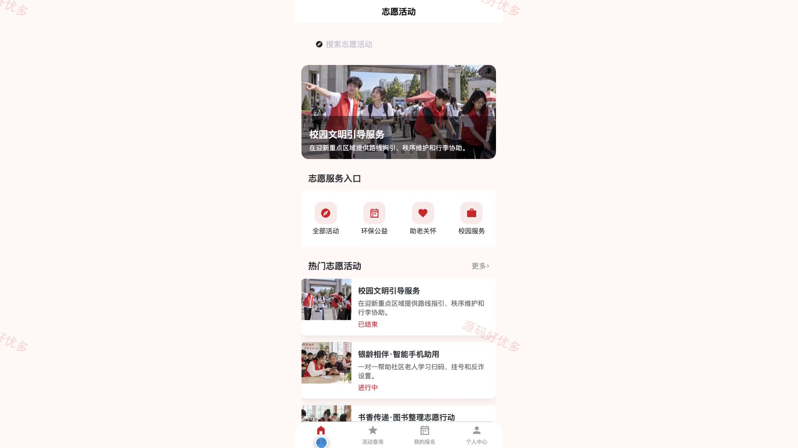
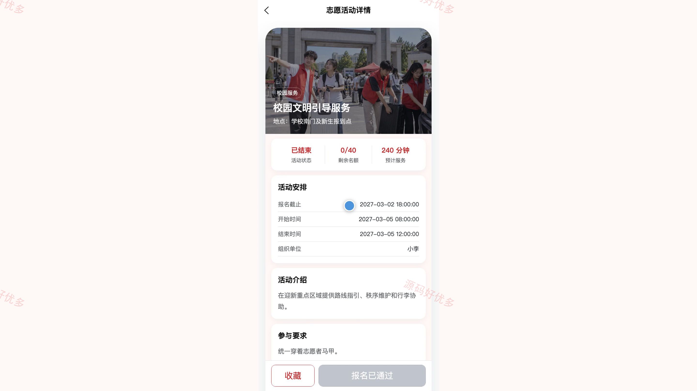
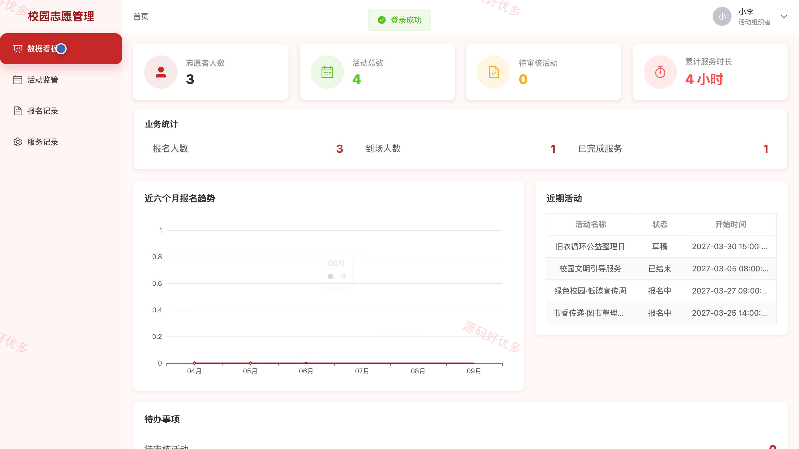
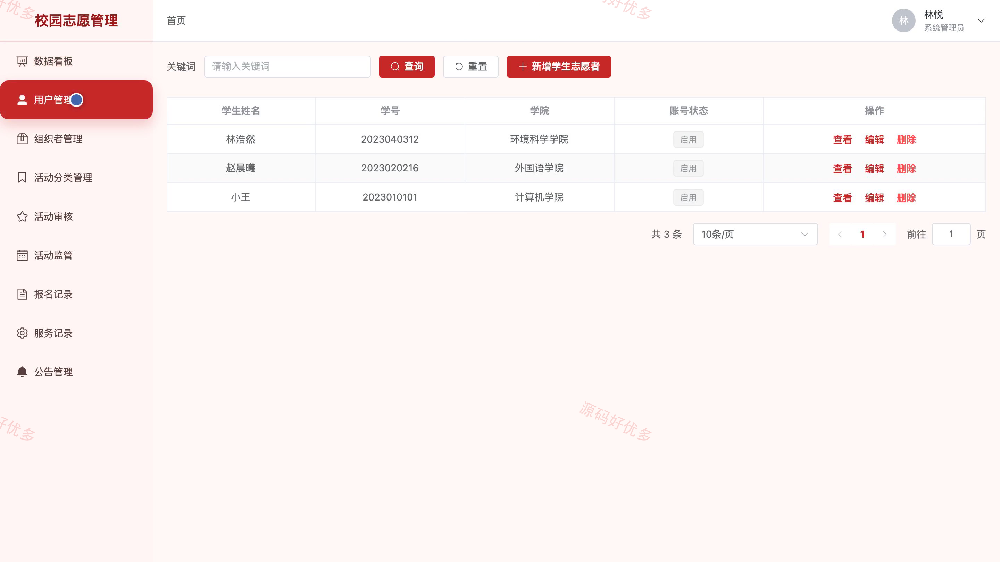
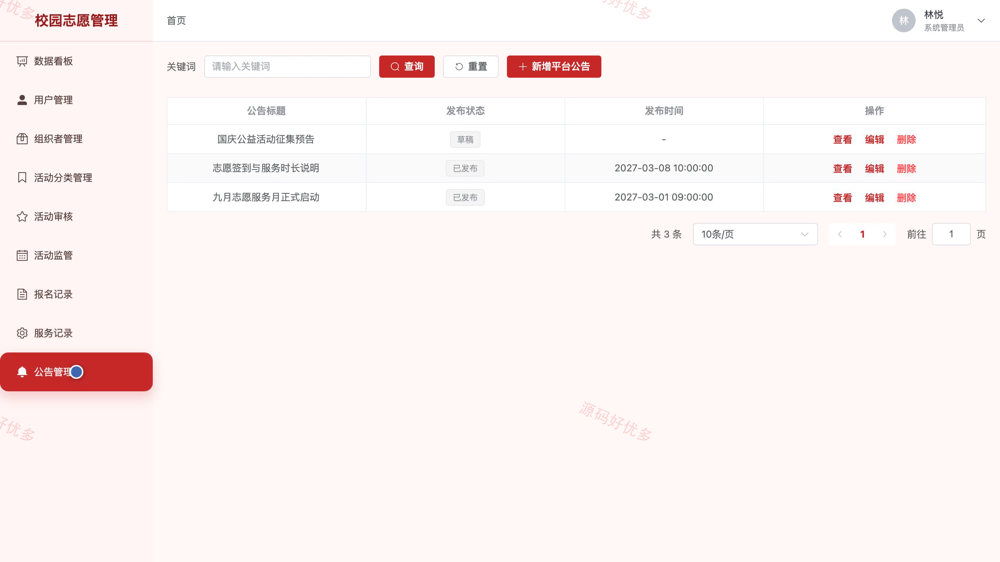

# bs019B
bs019B校园志愿者活动管理小程序源码 Java SpringBoot3 Vue3 文档 PPT
## 源码问题查看主页咨询

### 一、关键词
校园志愿服务、志愿活动报名、公益活动、服务时长、活动审核

### 二、作品包含
源码+数据库+万字设计文档+PPT+全套环境和工具资源+本地部署教程

### 三、项目技术
前端技术： Html、Css、Js、Vue3.4、Element-Plus、uniapp
后端技术：Java、SpringBoot3.2.0、MyBatis-Plus

### 四、运行环境要求
开发工具：IDEA/eclipse + VSCODE + HBuilder X + 微信开发者工具

数据库：MySQL5.7+（共14张表）

数据库管理工具：Navicat10以上版本

环境配置软件： JDK17 + Maven3.6

前端Nodejs：16+

浏览器：谷歌浏览器

### 五、项目介绍
项目编号：bs019B

校园志愿者活动管理小程序服务于学生志愿者、活动组织者和系统管理员，覆盖志愿活动发布与查询、报名审核、签到和服务时长确认。学生可在小程序参加活动并查询记录，组织者负责活动执行，管理员负责人员、分类、活动审核和平台公告。

角色：学生志愿者、活动组织者、系统管理员

学生志愿者功能：小程序登录与注册、志愿活动查询与详情浏览、活动报名与报名记录查询、活动收藏、服务记录与时长查看、平台公告查看、个人资料与密码维护。

活动组织者功能：后台登录与数据看板、志愿活动管理、报名记录管理、活动分类管理、签到与服务记录确认、个人资料维护。

系统管理员功能：后台登录与数据看板、学生志愿者管理、活动组织者管理、活动分类管理、志愿活动审核与监管、报名及服务记录管理、平台公告管理。

### 六、运行截图

